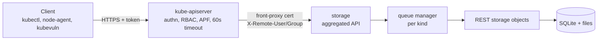
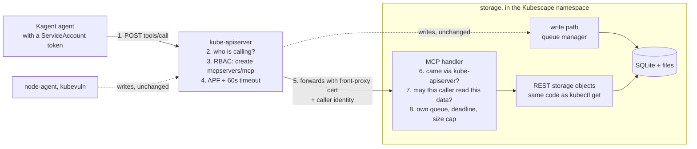
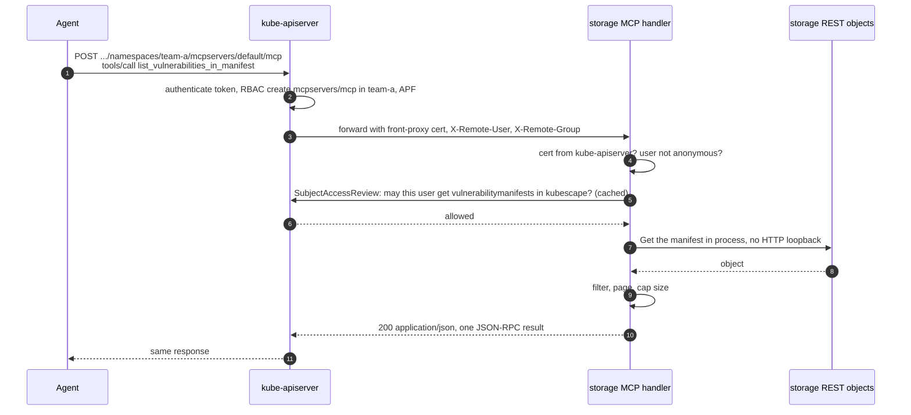
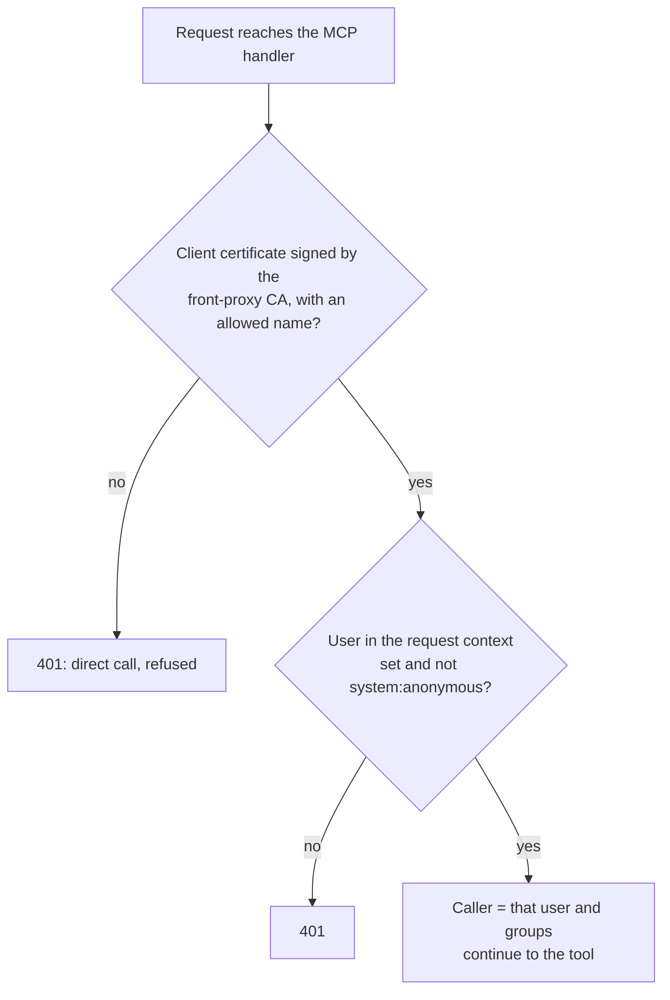
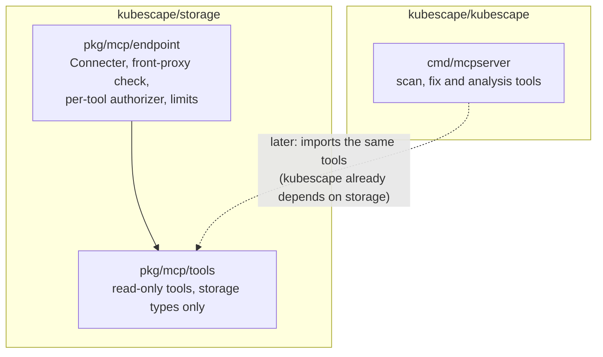

# Proposal: Read-only MCP endpoint in kubescape/storage

- **Status:** Proposed
- **Author:** Sarthak Shreshtha ([@Sarthak-Shreshtha01](https://github.com/Sarthak-Shreshtha01))
- **Date:** 2026-10-22
- **Scope:** [`storage`](https://github.com/kubescape/storage) (endpoint, auth, limits, tools);
  [`helm-charts`](https://github.com/kubescape/helm-charts) (values, RBAC); docs and a Kagent example
- **Roadmap:** item 5.1, Kagent and MCP support
- **Related:** [kubescape#4213](https://github.com/kubescape/kubescape/issues/4213) (in-cluster MCP server),
  [kubescape#4200](https://github.com/kubescape/kubescape/issues/4200) (paging and filters for MCP tools),
  [`storage-grpc-fastpath-auth.md`](storage-grpc-fastpath-auth.md) (authorization model for storage)

## 1. Summary

**In short:** AI agents that run inside a cluster, such as [Kagent](https://kagent.dev), cannot ask Kubescape anything today.
This proposal lets them. Storage, which already holds all of Kubescape's results, gets a small read-only "question
window" that speaks [MCP](https://modelcontextprotocol.io), the protocol agents use to call tools. Every question goes
through the Kubernetes API server first, so the cluster's normal login and permission rules decide who may ask and what
they may see. The window is closed by default.

**Technically:** `kubescape/storage` serves a new connect subresource,
`/apis/spdx.softwarecomposition.kubescape.io/v1beta1/namespaces/{ns}/mcpservers/default/mcp`, through its existing
aggregated API. It speaks MCP Streamable HTTP (protocol 2026-07-28, plus the earlier `initialize`-based revisions) with
plain JSON responses and no sessions. kube-apiserver authenticates
the caller, checks RBAC for `create` on `mcpservers/mcp`, applies priority-and-fairness and its 60s request timeout, and
proxies the call. Storage accepts only calls that carry kube-apiserver's front-proxy client certificate, checks each
tool's read against the caller's RBAC (SubjectAccessReview with a short cache), runs the call in its own queue with a
deadline and a size cap, and reads data through the same in-process storage objects the REST API uses. The first
version exposes the 9 read-only data tools that `kubescape mcpserver` already has (6.5; `list_sboms` and
`list_sbom_packages` came with [#4229](https://github.com/kubescape/kubescape/pull/4229)). `get_configuration_drift` is
left out: it also reads the workload itself from the Kubernetes API, which is not storage data.

## 2. Motivation

### The problem

The roadmap item for Kagent and MCP asks for Kubescape data to be available to agents in the cluster. Today:

| What exists | Why an in-cluster agent cannot use it |
|---|---|
| `kubescape mcpserver` (CLI, `cmd/mcpserver`) | A CLI command for a laptop or a workstation. Its SSE transport listens on `127.0.0.1` with no authentication, and the operator chart does not deploy it. |
| The Kubescape package in Kagent's tool server ([kagent-dev/tools#38](https://github.com/kagent-dev/tools/pull/38)) | 4 of its 10 tools read ApplicationProfile and NetworkNeighborhood, which storage removed in [storage#351](https://github.com/kubescape/storage/pull/351) (replaced by ContainerProfile), so they fail on a current install. It is pinned to storage v0.0.300 and lives outside the project. |
| Storage's REST API (`kubectl get vulnerabilitymanifests ...`) | Returns whole objects. The SBOM of one image (nginx:1.21) is 3.66 MB, and before [#4187](https://github.com/kubescape/kubescape/pull/4187) listing the vulnerabilities of the same image returned 698 KB (about 175k tokens). That does not fit in an agent's context. |

### Why storage

All the data agents ask about is already in storage. A separate MCP Deployment would read storage through
kube-apiserver anyway, which adds a hop and another component to run and secure (Slack, #kubescape-dev, 2026-10-20/21).
The open concern from the same discussion was that an MCP port on storage would bypass RBAC. This design answers it by
not adding a port: MCP goes through the same front door as every other storage request.

## 3. Words used in this proposal

| Term | Meaning |
|---|---|
| **MCP** | Model Context Protocol. An agent sends JSON-RPC messages such as `tools/list` and `tools/call`; the server answers with JSON. |
| **Streamable HTTP** | The MCP transport over plain HTTP POST. Since protocol 2026-07-28 there are no protocol-level sessions: every POST carries its protocol version (`MCP-Protocol-Version` header and `_meta`) and gets a complete answer. Older clients start with an `initialize` handshake; the endpoint answers it without keeping a session (mcp-go's stateless mode). |
| **Aggregated API** | A server (here: storage) that kube-apiserver forwards some API paths to. Storage serves `spdx.softwarecomposition.kubescape.io`. |
| **Front-proxy certificate** | The client certificate kube-apiserver uses when it forwards a request to an aggregated server. It proves "this request came from kube-apiserver", and the caller's identity travels in `X-Remote-User` / `X-Remote-Group` headers. |
| **RBAC** | Kubernetes roles: who may do which verb (`get`, `list`, `create`) on which resource in which namespace. |
| **SubjectAccessReview (SAR)** | An API call that asks kube-apiserver "may user X do verb Y on resource Z in namespace N?". |
| **APF** | API Priority and Fairness: kube-apiserver's per-client request limits, so one noisy client cannot starve others. |
| **Connect subresource** | A subresource that hands the raw HTTP request to the server's code, like `pods/exec` or `pods/proxy`. |

## 4. Current state

### How a request reaches storage today



Facts this design relies on (checked on storage `main` and the current chart):

- Storage has **no authorizer of its own**: `RecommendedOptions.Authorization = nil` in `pkg/cmd/server/start.go`. RBAC is
  enforced only by kube-apiserver.
- Storage's authenticator (k8s.io/apiserver's delegating authenticator) trusts the front-proxy certificate, **also accepts
  bearer tokens sent directly to it** (TokenReview), and **falls back to anonymous**.
- The chart binds storage's ServiceAccount to `system:auth-delegator`, so storage can already create TokenReviews and
  SubjectAccessReviews. Storage runs one replica.
- Storage's **queue manager** gives every resource kind its own queue (default length 100, 2 workers; chart
  `storage.kindQueues`). It reads the kind from the URL, so a new resource gets its own queue.
- LIST is **metadata-only by default**; full objects need `resourceVersion=fullSpec`, which is queued and expensive.
- kube-apiserver treats `watch` and the subresources `attach`, `exec`, `log`, `portforward` and **`proxy`** as
  long-running (`pkg/controlplane/apiserver/config.go`). Long-running requests skip APF and the 60s timeout. Everything
  else gets both.

### Where the data lives

This matters because RBAC is per namespace.

| Data | Resource | Stored in | Written by |
|---|---|---|---|
| Image vulnerabilities (full) | `vulnerabilitymanifests` | Kubescape's namespace | kubevuln |
| Image SBOMs | `sbomsyfts` | Kubescape's namespace | kubevuln |
| Vulnerability summaries per workload | `vulnerabilitymanifestsummaries` | the workload's namespace | kubevuln |
| Configuration scan per workload | `workloadconfigurationscans` | the resource's namespace | kubescape (operator scans) |
| Runtime profile per container | `containerprofiles` | the workload's namespace | node-agent |

## 5. Goals and non-goals

### Goals

- An MCP endpoint in storage that answers **only** calls that came through kube-apiserver from an authenticated user.
- **No new access:** a caller never reads more through MCP than `kubectl get` would show them for the same objects.
- **No harm to writes:** MCP calls cannot slow down node-agent and kubevuln writes.
- The same tool names, arguments and response shapes as `kubescape mcpserver`, so agents, prompts and docs carry over.
- Off by default, turned on with one chart value.

### Non-goals

- Tools that change the cluster, run scans or apply fixes. These stay in `kubescape mcpserver` (and the actions in
  `cli-cluster-operations.md`).
- Questions across many objects at once ("top 10 CVEs in the cluster", "which workloads ship package X"). This needs a
  query layer and is a follow-up that can build on this endpoint.
- Any change to the storage write path, to node-agent or kubevuln, or to how objects are stored.
- Streaming results, MCP sessions, multi-cluster access.

## 6. Proposed design

### 6.1 Big picture

**In short:** the agent talks to the Kubernetes API server, the API server checks who it is and forwards the question to
storage, storage checks again what the agent may read, answers from its own data, and keeps MCP work in its own lane.



### 6.2 The endpoint

```
POST https://kubernetes.default.svc/apis/spdx.softwarecomposition.kubescape.io/v1beta1/namespaces/{namespace}/mcpservers/default/mcp
Content-Type: application/json
Accept: application/json, text/event-stream
Authorization: Bearer <ServiceAccount token>
```

- `mcpservers` is a new namespaced resource that **stores nothing**. Its only job is to be the address of the endpoint.
  The `mcp` subresource is a `rest.Connecter` (the mechanism behind `pods/exec`) whose `Connect` hands the request to
  the MCP handler and accepts only `POST`. The only name accepted is `default`; anything else is 404.
- k8s.io/apiserver requires a subresource to have a parent resource whose kind is registered in the scheme, so this adds
  a small `MCPServer` API type (no fields beyond metadata, never stored) to `spdx.softwarecomposition.kubescape.io`.
- kube-apiserver turns `POST .../mcpservers/default/mcp` into the RBAC check **`create` on `mcpservers/mcp`** in
  `{namespace}`. That is the one new permission an agent needs, plus read access to the data it asks about (6.5).
- The subresource is **deliberately not called `proxy`**. kube-apiserver would treat a `proxy` subresource as
  long-running and skip APF and the timeout. Under any other name it keeps both (tested, section 7).

### 6.3 One tool call, step by step



**In short:** two permission checks happen. The API server checks "may you use the MCP window here?", and storage checks
"may you read this particular data?". Both use the cluster's existing roles.

### 6.4 Transport

MCP **Streamable HTTP in stateless mode, with streaming turned off**, built with
[mcp-go](https://github.com/mark3labs/mcp-go) v1.0.0 (`server.WithStateLess(true)`, `server.WithDisableStreaming(true)`).
kubescape's `go.mod` already pins mcp-go v1.0.0; storage does not use mcp-go today, so it gains it as a new dependency
at the same version, which keeps one major for Phase 5. Both options are unchanged in v1.0.0 (the prototype uses them).

Protocol versions the endpoint accepts (tested, section 7):

| Version | How the client starts |
|---|---|
| 2026-07-28 (current) | `server/discover`, then every request carries the version in `MCP-Protocol-Version` and `_meta` |
| 2025-11-25, 2025-06-18, 2025-03-26 | `initialize` + `notifications/initialized`; answered without a session |

- Each `tools/call` is one POST that returns `Content-Type: application/json`. No session ID, no long-lived connection,
  so the single storage replica is not a constraint and nothing holds a queue slot between calls.
- `GET` (the optional server-to-client stream) is not offered: `Connect` accepts only `POST`, so a `GET` gets 405
  (and needs RBAC `get` on `mcpservers/mcp` before it even reaches storage).
- Tools do not send progress notifications, so mcp-go never upgrades a response to an event stream.

### 6.5 Who may call, and what they may read

#### Step 1: did the call come through kube-apiserver?



Storage's authentication filter has already turned the `X-Remote-*` headers into a user in the request context (and
removed the headers). The handler adds one check on top: the connection's client certificate must chain to the
request-header CA and carry an allowed name, the same CA and names storage already loads from the
`kube-system/extension-apiserver-authentication` ConfigMap. It reuses k8s.io/apiserver's own verifier for this
(`x509request.NewDynamicCAVerifier` with `RequestHeaderConfig.CAContentProvider`). Only kube-apiserver holds that
certificate, so a request that passes came through kube-apiserver and its user came from the front-proxy headers.
This is needed because storage's default authenticator also accepts anonymous calls and bearer tokens sent straight to
it, and the design must not depend on network-level restrictions.

**In short:** if anything other than the API server calls storage's MCP window, even with a valid token or a forged
"I am admin" header, the answer is "401, go through the API server".

#### Step 2: may this caller read this data?

Each tool authorizes the read it is about to do, for the calling user and groups, before reading. Checks for a single
object include its name, so roles restricted with `resourceNames` work as they do with `kubectl get`:

| Tool | Check (verb, resource, namespace, name) |
|---|---|
| `list_vulnerability_manifests` | `list vulnerabilitymanifests` in the namespace listed (all namespaces needs cluster-wide `list`) |
| `list_vulnerabilities_in_manifest`, `list_vulnerability_matches_for_cve` | `get vulnerabilitymanifests` in the manifest's namespace, name = the manifest |
| `list_sboms` | `list sbomsyfts` |
| `list_sbom_packages` | `get sbomsyfts`, name = the SBOM |
| `list_configuration_security_scan_manifests` | `list workloadconfigurationscans` |
| `get_configuration_security_scan_manifest` | `get workloadconfigurationscans`, name = the scan |
| `list_container_profiles` | `list containerprofiles` |
| `get_container_profile` | `get containerprofiles`, name = the profile |

- The check uses k8s.io/apiserver's `DelegatingAuthorizerConfig` (SubjectAccessReview with an allow/deny cache), the
  mechanism `storage-grpc-fastpath-auth.md` proposes for the gRPC path. It runs inside the MCP handler only; no
  server-wide authorizer is added in front of the write path.
- A denied read returns an MCP tool error with code `RBAC_DENIED` (the error codes `kubescape mcpserver` already uses),
  not an HTTP error, so the agent can explain it to the user.
- **The path namespace is an RBAC handle and a default, not a scope.** It decides where the `create mcpservers/mcp`
  check happens and which namespace a tool uses when the agent gives none. What a tool may read is decided only by the
  per-tool check. A hard scope would break the main use case, because image vulnerabilities and SBOMs live in
  Kubescape's namespace while configuration scans and profiles live in workload namespaces.
- So an agent needs read access in Kubescape's namespace to see vulnerabilities and SBOMs, exactly as with `kubectl`,
  and an agent with access to one team namespace sees that team's configuration scans and container profiles.
  **Limitation:** vulnerability data is per image, not per tenant. Whoever may read it in Kubescape's namespace sees
  every image's results, as with `kubectl` today.

### 6.6 Protecting the write path

| Limit | Default | Why |
|---|---|---|
| Own queue (`kindQueues.mcpservers`) | length 10, 1 worker | MCP calls wait in their own line and never take a worker from profile or SBOM writes. A full queue answers 429. |
| Concurrency cap in the MCP handler | 1 call at a time, 10 waiting | The same limit enforced inside the handler, so it holds even when the queue manager is off (see below). |
| Request body size (`kindQueues.mcpservers.maxObjectSize`, and `http.MaxBytesReader` in the handler) | 64 KB | An MCP request is a few hundred bytes; anything larger is refused with 413 before it is read. |
| Deadline per call | 20s | Well under kube-apiserver's 60s and Kagent's default 30s tool timeout. Applied to the tool's work (mcp-go tool middleware), not to the HTTP request, so the agent always gets an answer: what the tool has with `truncated: true`, or a `TIMEOUT` tool error. |
| Response size cap | 256 KB | Keeps answers inside an agent's context. Lists page with `limit`/`offset` or `continue`. |
| Reads | metadata LIST, then GET by name | Never `fullSpec` LIST; full objects are read one at a time and only when a tool needs them. |

On top of these, kube-apiserver applies APF to every MCP call and cuts any call at 60s, and storage's own request
timeout applies too. When kube-apiserver cuts a call, the request context in storage is cancelled at the same moment, so
the work stops (tested, section 7). All values are configurable.

**Queue manager:** storage's own default is `queueManagerEnabled: false` (`pkg/config/config.go`), and `start.go` attaches
the queue handler only when it is true. The operator chart turns it on (`storage.queueManagerEnabled: true` in
`values.yaml`), which is how the prototype ran. Because the handler enforces its own concurrency cap and body limit, the
MCP limits do not depend on it: with the queue manager on, `mcpservers` also gets its own queue; with it off, the
handler's limits still apply.

**Per-client rate limiting:** when `rateLimitPerClient` is above 0 (off by default), `rateLimitTotal` (default 10) is a
concurrency limit shared by every request, so MCP calls would hold slots that node-agent and kubevuln writes also use.
The handler's cap keeps MCP to at most 1 of those slots; the Phase 2 load test runs once with rate limiting on to check.

### 6.7 What an agent sees

Request (one HTTP POST):

```json
{"jsonrpc": "2.0", "id": 7, "method": "tools/call",
 "params": {"name": "list_vulnerabilities_in_manifest",
            "arguments": {"namespace": "kubescape", "manifest_name": "<manifest name>",
                          "min_severity": "Critical", "limit": 2}}}
```

Response (`Content-Type: application/json`). The tool result is JSON text inside the MCP result, shown here unpacked:

```json
{"total": 31, "returned": 2, "truncated": true, "next_offset": 2,
 "vulnerabilities": [
   {"id": "<CVE id>", "severity": "Critical", "package": "<package>", "version": "<installed version>",
    "package_type": "deb", "fix": {"versions": ["<fixed version>"], "state": "fixed"}},
   {"...": "..."}]}
```

This is the shape `kubescape mcpserver` already returns since [#4187](https://github.com/kubescape/kubescape/pull/4187);
the agent asks for the next page with `"offset": 2`.

### 6.8 Code layout



- The read tools move into `pkg/mcp/tools` in storage. They depend only on storage's own API types, not on the CLI's
  scanning code (grype, syft, OPA).
- kubescape already imports `github.com/kubescape/storage`, so `kubescape mcpserver` can register the same package
  later. One copy of the tools, two ways to serve them.
- The tools take a small interface (`get`/`list` per kind). Storage passes its in-process REST objects; the CLI would
  pass its typed client.
- Until Phase 5 there are two copies of the read tools. To stop them drifting, both repos run the same golden tests:
  fixed input objects, and the expected tool list, argument schemas and responses as JSON files in storage, which
  kubescape's tests read from the storage module it already imports.

### 6.9 Configuration

```yaml
# helm-charts: charts/kubescape-operator/values.yaml (proposed)
storage:
  mcp:
    enabled: false          # off by default
    callTimeout: 20s
    maxResponseBytes: 262144
    readerClusterRoles: true # create the two ClusterRoles below
  kindQueues:
    mcpservers:
      queueLength: 10
      workerCount: 1
      maxObjectSize: 65536
```

```yaml
# Optional ClusterRoles the chart creates; users bind them per namespace or cluster-wide.
# Scan results:
apiVersion: rbac.authorization.k8s.io/v1
kind: ClusterRole
metadata:
  name: kubescape-mcp-reader
rules:
- apiGroups: ["spdx.softwarecomposition.kubescape.io"]
  resources: ["mcpservers/mcp"]
  verbs: ["create"]
- apiGroups: ["spdx.softwarecomposition.kubescape.io"]
  resources: ["vulnerabilitymanifests", "workloadconfigurationscans"]
  verbs: ["get", "list"]
---
# Runtime behaviour and full package inventories, more sensitive, so bound separately:
apiVersion: rbac.authorization.k8s.io/v1
kind: ClusterRole
metadata:
  name: kubescape-mcp-runtime-reader
rules:
- apiGroups: ["spdx.softwarecomposition.kubescape.io"]
  resources: ["containerprofiles", "sbomsyfts"]
  verbs: ["get", "list"]
```

Container profiles record what a container actually runs, opens and connects to, and SBOMs list every package in an
image, so an agent that only needs scan results gets `kubescape-mcp-reader` alone.

### 6.10 Using it from Kagent

Checked against Kagent `main` at v1.0.0-alpha17 (2026-10-21), API group `api.kagent.dev`:

```yaml
apiVersion: api.kagent.dev/v1alpha3
kind: RemoteMCPServer
metadata:
  name: kubescape
  namespace: kagent
spec:
  description: Kubescape vulnerability, SBOM, configuration and runtime data (read-only)
  protocol: STREAMABLE_HTTP
  url: https://kubernetes.default.svc/apis/spdx.softwarecomposition.kubescape.io/v1beta1/namespaces/kagent/mcpservers/default/mcp
  headersFrom:
  - name: Authorization
    valueFrom:
      type: Secret
      name: kubescape-mcp-token   # "Bearer <token>" of a ServiceAccount bound to kubescape-mcp-reader
      key: authorization
```

**Identity.** A header from `headersFrom` is the same for every call through that `RemoteMCPServer`, so every agent that
uses it acts as one ServiceAccount. Per-agent RBAC means one ServiceAccount, Secret and `RemoteMCPServer` per agent (or
per group of agents that may see the same data). Kagent's `tokenPassthrough` forwards the calling user's own token
instead, which only works when that token is valid for kube-apiserver, and needs tool discovery turned off for that
server; the example documents the static-token setup first.

**The token.** The Secret holds `Bearer <token>`. Two ways to get the token, both documented in the example:
- A `kubernetes.io/service-account-token` Secret: the token does not expire; rotating means deleting and recreating that
  Secret and updating `kubescape-mcp-token`.
- `kubectl create token` / TokenRequest: a bound token that expires (1h by default, longer with `--duration`). The
  static header cannot refresh itself, so this needs a small job or controller that rewrites the Secret before expiry.

**CA gap.** Kagent cannot trust a custom CA today. In v1alpha3 `TLSConfig` has only `disableVerify`;
`caCertSecretRef` and `caCertSecretKey` are present but commented out ("Deferred until custom CA bundles can be provided
to the runtime", `go/api/v1alpha3/modelconfig_types.go`), and the `RemoteMCPServer` field docs say "Custom CA bundles
are not supported". kube-apiserver's certificate is signed by the cluster CA, so the only option today is
`tls.disableVerify: true`, which the Kagent posture control C-0311 (`kagent-crd-posture-rules.md`) correctly flags. The
example documents this, and when Kagent enables `caCertSecretRef` the example switches to it (pointing at the
ServiceAccount's `ca.crt`).

## 7. Evidence: a prototype in storage, tested on kind

To check that the design works in storage itself and not only on paper, I built a prototype on storage `main`
(18c0968a): the `mcpservers` resource and `mcp` connect subresource, the front-proxy check, the per-tool authorizer, the
deadline, and three tools (`whoami`, `list_vulnerability_manifests` reading through the in-process REST object, and
`slow` for timing tests). It was deployed on kind v1.33.1 from the operator chart's storage templates (v0.0.345 base
image), with `kindQueues.mcpservers` set to length 1 and 1 worker to make the queue easy to fill. Calls used a
ServiceAccount token (`system:serviceaccount:mcp-test:agent`) through kube-apiserver unless noted.

| # | Test | Result |
|---|---|---|
| 1 | No RBAC | **403** from kube-apiserver: `cannot create resource "mcpservers/mcp" in API group "spdx.softwarecomposition.kubescape.io" in the namespace "mcp-test"` |
| 2 | Role with `create` on `mcpservers/mcp` in `mcp-test`: `initialize`, `whoami` | **200**, `application/json`; storage saw user `system:serviceaccount:mcp-test:agent`, its 3 groups and namespace `mcp-test` |
| 3 | `list_vulnerability_manifests` in `kubescape` without read permission there | Tool error **`RBAC_DENIED`** (HTTP 200, `isError: true`) |
| 4 | Same, after granting `list vulnerabilitymanifests` in `kubescape` | Both manifests returned, read in-process |
| 5 | Same token, data in `default` | **`RBAC_DENIED`** |
| 6 | Endpoint in another namespace | **403** |
| 7 | Name other than `default` | **404** |
| 8 | Direct call to the storage Service from a pod, skipping kube-apiserver: no credentials / valid SA token / forged `X-Remote-User: system:admin` + `X-Remote-Group: system:masters` | **401** for all three |
| 9 | Tool that wants 30s | **`TIMEOUT`** tool error after **20.0s** (HTTP 200, JSON) |
| 10 | 3 calls at once with queue length 1 | 1 × **200**, 2 × **429** `Too Many Requests (queue full)` in 11 ms |
| 11 | VulnerabilityManifest writes while the MCP worker was busy | 0.15–0.19s each, unaffected |
| 12 | Request body over 64 KB | **413** `Request entity too large` |
| 13 | `GET` with `get` permission | **405** `MethodNotAllowed` |
| 14 | mcp-go v1.0.0 client, default settings, with the cluster CA and a bearer token | `server/discover` → **2026-07-28**, then `tools/list` and `tools/call` with `MCP-Protocol-Version: 2026-07-28`; no `initialize` on the wire |
| 15 | Endpoint switched off | **404**; `mcpservers` not in discovery |
| 16 | mcp-go client pinned to 2025-11-25, 2025-06-18 and 2025-03-26 | `initialize` → that version, `notifications/initialized` → 202, `tools/list` and `tools/call` work for all three |
| 17 | The MCP Python SDK version Kagent's agent runtime pins (`mcp` 2.3.0, from Kagent's `uv.lock`) | `initialize()` → 2025-11-25 and `discover()` → 2026-07-28; `tools/list` and `tools/call` work with both |
| 18 | The Go SDK Kagent's controller uses for `RemoteMCPServer` tool discovery (`modelcontextprotocol/go-sdk` v1.8.0, `StreamableClientTransport`, headers set by an `http.Client` as in Kagent) | 2026-07-28; `tools/list` and `tools/call` work |

Two kube-apiserver behaviours were checked with a throwaway aggregated server using the same path shape: a 70s call
is cut with **504** after **60.0s** and the server's request context is cancelled at the same moment, and
`apiserver_flowcontrol_dispatched_requests_total{flow_schema="service-accounts"}` grows by one per MCP call (APF
applies). An earlier run with a `proxy` subresource held a stream for 80s+, confirming that `proxy` skips the timeout.

### What the prototype changed in this design

- **Where the caller comes from:** storage's authentication filter removes the `X-Remote-*` headers once it has put the
  user in the request context, so the handler reads the user from the context and checks the certificate separately
  (6.5). Re-reading the headers would not work.
- **Where the namespace comes from:** the path namespace is on the context `Connect` receives, not on the request its
  handler gets, so `Connect` has to carry it over.
- **Where the deadline goes:** a deadline on the HTTP request made mcp-go drop the answer, and the agent got an empty
  `200`. On the tool's work it returns a proper `TIMEOUT` result (test 9).
- **The parent kind:** the prototype reused an existing kind for `mcpservers`; the real change needs the `MCPServer`
  type (6.2).

## 8. Security considerations

| Topic | What the design does |
|---|---|
| **Audit** | One structured log line per tool call: user, groups, tool, path namespace, target namespace and name, allowed or denied (with the SAR reason), duration, response bytes, error code. kube-apiserver's audit log already records the `create mcpservers/mcp` request itself; this line adds which data the call read. |
| **Metrics** | Calls by tool and outcome (ok, `RBAC_DENIED`, `TIMEOUT`, error), call latency, response size, queue rejections (429), SAR cache hits and misses. |
| **Untrusted text reaching an LLM** | Object names, labels, annotations, package names and CVE descriptions are written by workload owners or upstream feeds, and the agent's model reads them. Tools return them only as JSON field values, never as free text mixed with tool instructions; tool descriptions say the fields are data; long strings are cut and the response is capped (256 KB). All tools are read-only, so a prompt injection in the data cannot make the endpoint change anything. Agents must still treat tool output as untrusted input. |
| **Denial of service by allowed callers** | A caller with the right RBAC can still send many calls. Limits: APF per user in kube-apiserver, the MCP queue and concurrency cap in storage (calls beyond it get 429, writes keep their own queues), the 20s deadline, metadata-only LISTs, the response cap, and the SAR cache that bounds SubjectAccessReview load. |
| **Calls that skip kube-apiserver** | Refused with 401 (front-proxy certificate check, 6.5), so the endpoint does not depend on network policy. |

## 9. Errors and what the agent gets back

| Situation | Answer |
|---|---|
| No permission to use the endpoint in that namespace | HTTP 403 from kube-apiserver |
| Call did not come through kube-apiserver, or anonymous | HTTP 401 from storage |
| MCP turned off in the chart | HTTP 404 (the resource is not registered) |
| Queue full | HTTP 429 |
| Request body too large | HTTP 413 |
| `GET` or any method other than `POST` | HTTP 405 |
| No permission to read the data a tool needs | Tool error `RBAC_DENIED` |
| Object not found | Tool error `RESOURCE_NOT_FOUND` |
| Bad arguments | Tool error `INVALID_ARGUMENT` |
| Deadline reached | Partial result with `truncated: true`, or tool error `TIMEOUT` |
| Call longer than 60s | HTTP 504 from kube-apiserver (should not happen with a 20s deadline) |

## 10. Rollout

| Phase | Repo | What | Done when |
|---|---|---|---|
| 1a | storage | `MCPServer` API type with its generated code (deepcopy, clientset, listers, informers, OpenAPI, protobuf, as in [storage#351](https://github.com/kubescape/storage/pull/351)); nothing served yet | Codegen check passes; no behaviour change |
| 1b | storage | `mcpservers` resource and `mcp` connect subresource behind a config flag (off), front-proxy check, per-tool authorizer, audit line, one tool (`list_vulnerability_manifests`) | The tests in section 7 as unit and kind tests, including Kagent's two MCP clients (tests 17 and 18) |
| 2 | storage | Queue, concurrency cap, deadline, size cap, metrics; `pkg/mcp/tools` with the other 8 tools and the golden tests (6.8) | Load test: MCP calls next to node-agent writes, write latency unchanged, once with `rateLimitPerClient` on |
| 3 | helm-charts | `storage.mcp.*` values, the two reader ClusterRoles, docs | `helm template` with MCP on and off |
| 4 | docs, kagent | Kagent example (RemoteMCPServer + Agent, token setup), CA option followed upstream | A Kagent agent answers "which critical CVEs are in namespace X" on kind |
| 5 | kubescape | Optional: `kubescape mcpserver` uses `pkg/mcp/tools` | One copy of the read tools |

Phase 1a is mostly generated code; the other phases are one or two small PRs each.

## 11. Test plan

- **Unit (storage):** the front-proxy check (no cert, wrong CA, wrong name, anonymous, valid); the per-tool authorizer
  with a fake SAR client (allowed, denied, cached); each tool against the in-process objects with paging, filters and the
  size cap.
- **Integration (kind):** the tests in section 7 against the real change; a Role scoped to one namespace sees only that
  namespace's data.
- **Load:** MCP calls in a loop while node-agent writes ContainerProfiles; compare write latency and `database is locked`
  errors with MCP off and on.
- **Protocol versions:** one client on 2026-07-28 (`server/discover`) and one on an `initialize`-based version, in CI.
- **Kagent clients (before Phase 1b merges):** Kagent's Python runtime client and its Go discovery client against the
  real change on kind (tests 17 and 18).
- **Kagent end to end (Phase 4):** RemoteMCPServer discovers the tools and an Agent answers a question from real scan data.

## 12. Alternatives considered

| Option | Why not (for the first version) |
|---|---|
| A separate MCP port on storage with its own TokenReview + SubjectAccessReview | Bypasses kube-apiserver: storage would have to reimplement authentication, APF and timeouts, and expose a second port. |
| A `proxy` subresource (like `pods/proxy`) | Allows long streams, but kube-apiserver then skips APF and the timeout, and storage must bound everything itself. Not needed for request/response tools. |
| Run `kubescape mcpserver` as its own Deployment | Adds a component and a hop, pulls in the CLI's scan dependencies, and still needs auth. All the data is in storage. |
| A plain collection path (`namespaces/{ns}/mcp`) with no resource | Works in a test server, but in storage every path under the API group is routed to a registered resource, so it would need a resource anyway; a connect subresource is the standard way to hand a raw request to custom code. |
| Only update the Kubescape package in kagent-dev/tools | Fixes Kagent only and keeps a second copy of the tools outside the project. |

## 13. Open questions

1. **Cache duration** for the per-tool authorizer: shorter means RBAC changes apply sooner, longer means fewer
   SubjectAccessReviews. `storage-grpc-fastpath-auth.md` leaves the same question open; one answer for both would be good.
2. **Default limits** (queue 10/1, 20s, 256 KB) are a starting point; the load test in phase 2 should set them.
3. **Kagent CA:** wait for Kagent to enable `caCertSecretRef`, or offer to help land it upstream.
4. **Resource name:** `mcpservers/mcp` reads clearly, but another name may fit the API group better.

## 14. References

- Slack discussion: #kubescape-dev, 2026-10-16 to 2026-10-22 (Ben Hirschberg, Matthias Bertschy, Mohit Yadav)
- [`storage-grpc-fastpath-auth.md`](storage-grpc-fastpath-auth.md): authorization model for storage
- [`kagent-crd-posture-rules.md`](kagent-crd-posture-rules.md): control C-0311 (`tls.disableVerify`)
- [MCP Streamable HTTP transport, revision 2026-07-28](https://modelcontextprotocol.io/specification/2026-07-28/basic/transports)
- [MCP versioning](https://modelcontextprotocol.io/docs/learn/versioning)
- [Kubernetes API aggregation: authentication flow](https://kubernetes.io/docs/tasks/extend-kubernetes/configure-aggregation-layer/#authentication-flow)
- [API Priority and Fairness](https://kubernetes.io/docs/concepts/cluster-administration/flow-control/)
