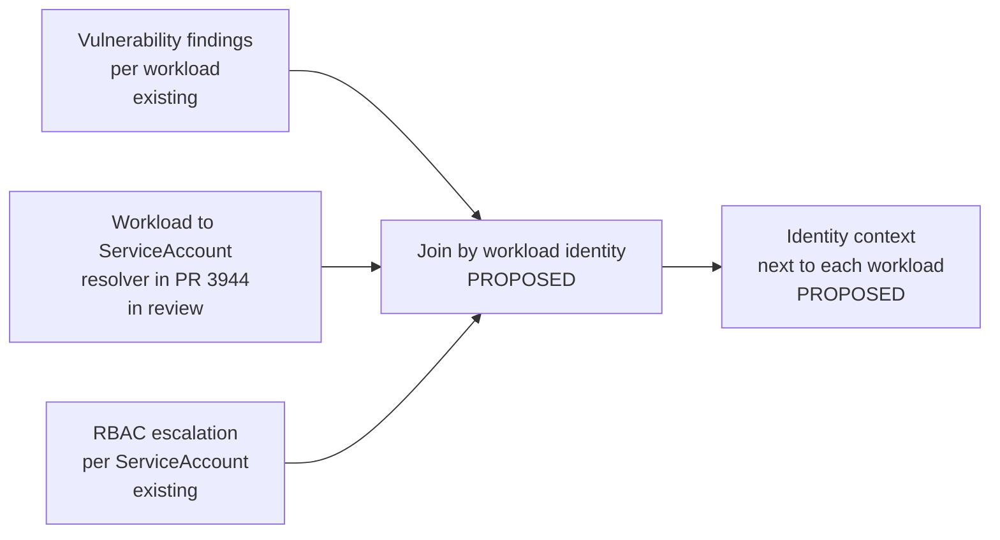
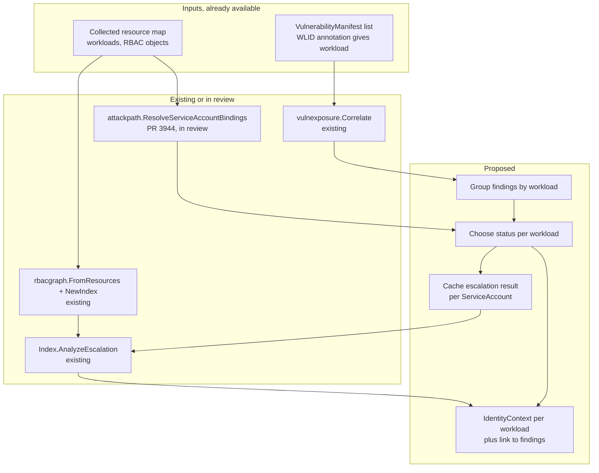

# Proposal: Correlating Workload Vulnerabilities with ServiceAccount RBAC Escalation

- **Status:** Draft – discussion
- **Author:** Vanshika ([@vanshika2720](https://github.com/vanshika2720))
- **Date:** 2026-10-14
- **Scope:** [`kubescape`](https://github.com/kubescape/kubescape) (`core/pkg/vulnexposure`, `core/pkg/rbacgraph`, and the `core/pkg/attackpath` package that is still in review). `cmd/mcpserver` is a possible later consumer only.
- **Related:**
  - [kubescape/kubescape#3632: correlate vulnerabilities with NetworkPolicy exposure](https://github.com/kubescape/kubescape/pull/3632) (merged)
  - [kubescape/kubescape#3681: model multi-hop RBAC privilege-escalation paths](https://github.com/kubescape/kubescape/pull/3681) (merged)
  - [kubescape/kubescape#3944: attackpath Phase 1, shared input adapter and resolvers](https://github.com/kubescape/kubescape/pull/3944) (open, changes requested)
  - [kubescape/kubescape#4024](https://github.com/kubescape/kubescape/pull/4024) to [#4028](https://github.com/kubescape/kubescape/pull/4028): attackpath Phases 2 to 6 (open drafts)
- **Related work:** [`attack-path-analysis`](./attack-path-analysis.md) (this repository, merged as PR #20), [`vex-ingestion`](./vex-ingestion.md), [`evidence-of-finding`](./evidence-of-finding.md)

Code links point at `kubescape/kubescape` `master` at `0e6ca711`, or at the head of PR #3944 (`e72f99f1`) where the code is not merged yet. Links are file-level. Nothing in this proposal was run on a cluster; [Appendix A](#appendix-a-how-the-claims-were-checked) lists what was read and what could not be inspected.

## Summary

- Kubescape can tell you which CVEs sit on a workload and how reachable that workload is. It can separately tell you what a ServiceAccount can escalate to. It does not connect the two for one workload.
- A Critical CVE on a workload that runs as a ServiceAccount with a path to `cluster-admin` is a different conversation from the same CVE on a workload whose ServiceAccount can do nothing. Today the operator has to join those by hand.
- We propose a small, caller-independent Go function that takes the existing vulnerability findings, the workload's ServiceAccount (from the resolver being added in the attackpath work), and the existing RBAC escalation result, and returns that context next to each workload.
- The result is context about blast radius. It does not change severity, and it does not say the workload is exploitable.
- The main open decision is where it lives: inside the attackpath implementation, or as a function that attackpath can call later. The proposal recommends the second, without waiting for the graph work.

## Motivation

### The problem

An operator gets a list of vulnerable workloads. They sort by severity and by reachability, which `analyze_vulnerability_exposure` already supports. Two Critical findings look the same:

| | Workload A: `shop/web` | Workload B: `shop/report-gen` |
|---|---|---|
| CVE | Critical, fix available | Critical, fix available |
| Reachable from | Ingress | Ingress |
| ServiceAccount | `web` (no bindings) | `report-gen` |
| What `report-gen` can do | – | `create pods` in `shop`, and a ServiceAccount in `shop` is bound to `cluster-admin` |

For B, if an attacker gets code execution in the pod and the token is mounted, the RBAC graph says the token can be used to run a pod as the privileged ServiceAccount (`assign-serviceaccount` in [`rbacgraph`](https://github.com/kubescape/kubescape/blob/0e6ca711388ae4ed664451759050632c7e48d757/core/pkg/rbacgraph/types.go)). A has no such step. Severity and reachability are identical, so the existing report does not separate them.

The example is hypothetical. It is here to show the shape of the question, not a finding in a real cluster.

### What is established and what is assumed

| Statement | Status |
|---|---|
| The workload has this CVE | Established, from a `VulnerabilityManifest` |
| The workload is reachable by NetworkPolicy or Service/Ingress/Gateway | Established as an upper bound by `networkpolicy` and `exposure` |
| The workload runs as ServiceAccount `X` | Established from the workload spec, if the object is in the snapshot |
| `X` has RBAC rules that chain to `cluster-admin` | Established as an upper bound by `rbacgraph`, from RBAC objects only |
| The CVE can be exploited | **Not established.** Nothing here checks it |
| The attacker can reach the token | **Assumed** after code execution; depends on the token actually being mounted |
| Admission control (PSA, Kyverno, Gatekeeper) would not block the pod creation | **Assumed.** `rbacgraph` states it does not model admission |

The proposal reports the first four, flags the last three, and never merges them into one verdict.

### What exists today

- `vulnexposure.Correlate` joins vulnerabilities with NetworkPolicy exposure and external exposure. Its `Finding` has no ServiceAccount or RBAC field ([`correlate.go`](https://github.com/kubescape/kubescape/blob/0e6ca711388ae4ed664451759050632c7e48d757/core/pkg/vulnexposure/correlate.go)).
- `rbacgraph.Index.AnalyzeEscalation(Subject)` returns reachable identities, unbounded findings, `ClusterAdmin` and `Truncated` for a starting subject ([`closure.go`](https://github.com/kubescape/kubescape/blob/0e6ca711388ae4ed664451759050632c7e48d757/core/pkg/rbacgraph/closure.go)).
- The MCP tool `analyze_vulnerability_exposure` imports `exposure`, `networkpolicy` and `vulnexposure`, and not `rbacgraph` ([`vulnerability_exposure.go`](https://github.com/kubescape/kubescape/blob/0e6ca711388ae4ed664451759050632c7e48d757/cmd/mcpserver/vulnerability_exposure.go)). The RBAC tool `rbac_escalation.go` takes a subject you name; it never starts from a workload.
- On `master`, outside the anonymizer and `reportcrypto`, no non-test Go code reads a workload's `serviceAccountName` (searched with `git grep`). The only resolver is in PR #3944.

So the gap is narrow and specific: **nothing maps a vulnerable workload to its ServiceAccount and hands that subject to `AnalyzeEscalation`.** All three pieces exist or are in review. The link between them does not.

## Goals

1. For each workload that has vulnerability findings, report which ServiceAccount it runs as and what the existing RBAC analysis found for that ServiceAccount.
2. Reuse the ServiceAccount resolution from the attackpath work. Do not write a second resolver.
3. Keep the four things separate in the output: vulnerability present, token mounted, escalation found, exploitation (never claimed).
4. Say "could not determine" when the data cannot support a join. Never read it as "safe".
5. Do not change severity, ordering of existing findings, or the output of existing MCP tools.
6. Run the RBAC analysis once per ServiceAccount, not once per CVE.

## Non-goals

- Deciding that a CVE is exploitable, or ranking by exploitability.
- New escalation primitives in `rbacgraph`.
- Modeling admission control, runtime behavior, or whether the app reads its token.
- A generic graph or a new scoring formula. That belongs to the attackpath Phase 2 discussion.
- Making MCP, or any CLI command, a prerequisite. This is Go-level analysis first.

## How it works: simple view



Only the join and its output are new. The three inputs exist, one of them as an open PR.

## How it works: complete architecture



### Step by step

**1. Findings and workload identity.** `Correlate` returns `Finding` values keyed by `vulnexposure.Workload{Namespace, Kind, Name}`. That key comes from the WLID annotation on the manifest (`workloadFromManifest` in the MCP tool). A manifest without a WLID is skipped there as image-level, and the same rule applies here: no WLID, no join.

**2. ServiceAccount resolution.** Call `ResolveServiceAccountBindings` from PR #3944 once over the collected resource map, with the `ServiceAccountAutomountIndex` built from the ServiceAccounts `rbacgraph.FromResources` returns. Per its code, for each workload of a supported kind it reads `spec.serviceAccountName` (or the pod template path for controllers and CronJob), uses `default` when empty, and computes `TokenMounted` from the projected-token volume, pod-level and ServiceAccount-level `automountServiceAccountToken`, and mount-path occupancy. The join only looks up its result by workload; it re-implements none of this.

Two details of the resolver matter for the join. It never sets the `Skipped` field it declares: a workload of an unsupported kind, or one absent from the resource map, is simply not in the output. So the join treats "no binding returned" as `workload-unresolved`. And it does not record whether the name came from the `default` fallback, so an explicit `default` cannot be told apart from an omitted field.

**3. Status per workload.** The join does not guess. Each workload gets exactly one status (see [Result semantics](#result-semantics-and-edge-cases)).

**4. Escalation, once per ServiceAccount.** Several workloads usually share a ServiceAccount, and one workload usually has many CVEs. The join builds one `rbacgraph.Index` and calls `AnalyzeEscalation` at most once per `Subject{KindServiceAccount, ns, name}`.

**5. Output.** One `IdentityContext` per workload, referenced from the findings by workload key. The CVE rows are not duplicated per escalation path.

### Result shape (illustrative)

```go
// Illustrative, not final names.
type IdentityContext struct {
    Workload       vulnexposure.Workload
    ServiceAccount string // resolved name, "" if unresolved
    TokenMounted   bool
    Status         IdentityStatus
    // Nil unless Status == IdentityAnalyzed. A zero ClusterAdmin or an empty
    // Reached in here is not a safety statement; read Truncated and Unbounded too.
    Escalation *rbacgraph.EscalationResult
    Reason     string // why not analyzed, if applicable
}

type IdentityStatus string

const (
    IdentityAnalyzed           IdentityStatus = "analyzed"
    IdentityTokenNotMounted    IdentityStatus = "token-not-mounted"
    IdentityWorkloadUnresolved IdentityStatus = "workload-unresolved"
    IdentityRBACUnavailable    IdentityStatus = "rbac-unavailable"
)
```

`Escalation` is the existing `EscalationResult` passed through. The proposal does not define a new "risk" enum on top of it.

What each status means:

| Status | Meaning | Does not mean |
|---|---|---|
| `analyzed` | The workload resolved to a ServiceAccount, RBAC was collected, and `AnalyzeEscalation` ran | That the ServiceAccount is safe, or that it gains no permissions. With an empty `Reached` and `ClusterAdmin=false` it means only that no further identity or cluster-admin reachability was found in what was collected. Consumers must also read `EffectiveRules`, `Truncated`, `Unbounded` and `ScopeUnknown` |
| `token-not-mounted` | The resolver reports no token reaches the pod, so escalation was not run | That no path exists for the ServiceAccount itself. Only that this workload is not shown to hold its token (see Q2) |
| `workload-unresolved` | No binding came back for the workload | Anything about its identity or RBAC |
| `rbac-unavailable` | RBAC objects were not collected or listing failed | An empty escalation result |

Whether `analyzed` with no path should be a separate status from `analyzed` with `Truncated` is something maintainers may prefer; this proposal keeps one status and passes the flags through.

## What we can reuse

| What | Where | Used for | Change |
|---|---|---|---|
| `Workload`, `Finding`, `Correlate` | [`core/pkg/vulnexposure/correlate.go`](https://github.com/kubescape/kubescape/blob/0e6ca711388ae4ed664451759050632c7e48d757/core/pkg/vulnexposure/correlate.go) | Findings keyed by workload | None |
| `FromResources`, `NewIndex` | [`core/pkg/rbacgraph/adapter.go`](https://github.com/kubescape/kubescape/blob/0e6ca711388ae4ed664451759050632c7e48d757/core/pkg/rbacgraph/adapter.go), [`index.go`](https://github.com/kubescape/kubescape/blob/0e6ca711388ae4ed664451759050632c7e48d757/core/pkg/rbacgraph/index.go) | RBAC index from collected objects | None |
| `Subject`, `AnalyzeEscalation`, `EscalationResult` | [`types.go`](https://github.com/kubescape/kubescape/blob/0e6ca711388ae4ed664451759050632c7e48d757/core/pkg/rbacgraph/types.go), [`closure.go`](https://github.com/kubescape/kubescape/blob/0e6ca711388ae4ed664451759050632c7e48d757/core/pkg/rbacgraph/closure.go) | Escalation from a ServiceAccount | None |
| Implicit-group handling (`system:serviceaccounts`, `system:authenticated`) | `bindingNamesSubject` in [`index.go`](https://github.com/kubescape/kubescape/blob/0e6ca711388ae4ed664451759050632c7e48d757/core/pkg/rbacgraph/index.go) | Default ServiceAccount gets group-granted rules | None |
| `ResolveServiceAccountBindings`, `ServiceAccountAutomountIndex` | [`core/pkg/attackpath/serviceaccount.go`](https://github.com/kubescape/kubescape/blob/e72f99f1f9e83125135f65616469a2760178eeaf/core/pkg/attackpath/serviceaccount.go), [`serviceaccount_index.go`](https://github.com/kubescape/kubescape/blob/e72f99f1f9e83125135f65616469a2760178eeaf/core/pkg/attackpath/serviceaccount_index.go) (PR #3944) | Canonical workload to ServiceAccount and token mount | None; depends on the PR merging |
| `WorkloadKindGVRs`, `PodTemplateLabels` | [`core/pkg/attackpath/workload.go`](https://github.com/kubescape/kubescape/blob/e72f99f1f9e83125135f65616469a2760178eeaf/core/pkg/attackpath/workload.go) (PR #3944) | Supported workload kinds | None |
| `workloadFromManifest` | [`cmd/mcpserver/vulnerability_exposure.go`](https://github.com/kubescape/kubescape/blob/0e6ca711388ae4ed664451759050632c7e48d757/cmd/mcpserver/vulnerability_exposure.go) | WLID to `Workload` | Possibly moved to a shared package so a non-MCP caller can use it |
| Printer registry, `IPrinter` | `core/pkg/resultshandling/printer` | Reporting | Not touched in the first version |

What we cannot reuse: nothing joins the workload to the RBAC index. That is the only new logic.

## Where the correlation belongs

Two options. Neither is decided by the code alone.

**Option A: extend the attackpath implementation.** Add a CVE node and a `runs-as` edge in the Phase 2 graph builder, and let `escalates` edges follow from the ServiceAccount node.

**Option B: a small function over existing results.** A function with the shape `(findings, bindings, rbacIndex) -> []IdentityContext`, with no graph.

What the code shows:

- The workload-to-ServiceAccount resolver exists only in the attackpath package and only as an open PR. Option B would call it. That is not a second resolver.
- **Verified imports.** At the head of PR #3944 the non-test `attackpath` files import `exposure`, `networkpolicy` and `rbacgraph`, and not `vulnexposure`. `vulnexposure` on `master` imports only `exposure` and `networkpolicy`. `cmd/mcpserver` imports `attackpath` in that PR. So a function in `attackpath` that uses `rbacgraph` and the resolver adds one edge, `attackpath` to `vulnexposure`, and creates no cycle today.
- **Inference, not verified.** If later phases make `attackpath` import `vulnexposure`, then `vulnexposure` could never host this function (it would need `attackpath`, a cycle). PR #4026's description mentions a bridge in `attackpath` so the CLI does not import `vulnexposure` directly, which points that way. The Phase 2 to 6 code was not inspectable (see the appendix), so this needs confirmation.
- The function could also key on `attackpath.WorkloadRef` instead of `vulnexposure.Workload` (same three fields) and avoid the new edge entirely, at the cost of a conversion at the call site.
- Option A depends on Phases 2 to 6 landing. As of inspection those PRs were drafts and their heads did not contain the files their descriptions list.
- Option B does not conflict with Option A. A graph builder can call the same function, or replace it, later.

**Provisional recommendation:** Option B, placed in `core/pkg/attackpath` as a function that does not need the graph builder, so the dependency direction stays one way and no new package is needed. If maintainers want `attackpath` to stay graph-only, a small sibling package is the fallback. This needs maintainer confirmation (Q1).

## Result semantics and edge cases

The rule for all cases: no inferred relationships, and "not found" is not "safe".

| Case | Status / behavior | What we say |
|---|---|---|
| Workload has no `serviceAccountName` | The resolver returns `default`. Analyze `default` | Report the name. The resolver does not record that it was defaulted, so the report cannot say so unless the resolver is extended |
| Default ServiceAccount, no direct bindings | Analyze it. Group bindings (`system:serviceaccounts*`) are included by `rbacgraph` | Report what `AnalyzeEscalation` returns; may be empty |
| ServiceAccount resolved, no identity or cluster-admin reachability found | `analyzed`, `ClusterAdmin=false`, empty `Reached`, no `Unbounded` | "No additional identity or cluster-admin reachability was found in the collected RBAC objects." Not "no escalation", and not "safe". `EffectiveRules` may still hold finite permission gains (see below) |
| `Truncated` is true | `analyzed`, keep `Truncated` | "Search ran out of budget; absence of a path is not confirmed" |
| `ScopeUnknown` edge present | `analyzed`, keep the warning | Show the warning. It does not establish authority (per `rbacgraph`) |
| `ClusterAdmin` true | `analyzed`, pass through | "Cluster-admin-equivalent power is reachable by RBAC alone". `Reached` may be incomplete by design |
| `TokenMounted` false | `token-not-mounted`. Do not run escalation | Say the resolver found no mounted token. The projected-token handling is still being corrected in review, in both directions, so a wrong `false` would hide a path. Alternative: run escalation anyway and carry the flag (Q2) |
| ServiceAccount not in the snapshot | Still analyze (bindings can name it), but flag it | "ServiceAccount object not in collected resources" |
| RBAC objects not collected or list failed | `rbac-unavailable` | Never an empty escalation result. This mirrors how the MCP tool treats a forbidden Service list |
| Workload kind not supported, or object absent | `workload-unresolved`, with the resolver's reason | Listed, not guessed. Same as `Correlate`'s skipped list |
| Several containers, several manifests, same CVE | One `IdentityContext` per workload. Findings are not merged by this proposal | See Q6: the MCP path does not dedupe today, and whether this case arises is not verified |
| Manifest has no WLID | Skipped as image-level | Counted in a warning, as in the MCP tool |
| Workload has permissions but analysis cannot establish a path | Same as the row above, or `Truncated` | We do not report a path we cannot show, and we do not read the absence of one as safety |

### Finite permission gains

Empty `Reached`, no `Unbounded` and `ClusterAdmin=false` answer one question: can the ServiceAccount reach another identity or cluster-admin-equivalent power. They do not say its permissions stay the same. The RBAC closure also adopts finite rule sets without reaching anyone: with `create` on `rolebindings` and `bind` on a named Role, the ServiceAccount can adopt that Role's rules, for example `get`/`list` on `secrets` in one namespace. The result is that `EffectiveRules` grows while `Reached`, `Unbounded` and `ClusterAdmin` stay empty or false.

So a join that only reads those three fields would under-report. Rules for this proposal:

- The negative message is limited to identity and cluster-admin reachability, as worded in the table above.
- `EffectiveRules` is passed through with the result and must be read together with it. Because it also contains the ServiceAccount's direct rules, a possible gain is what it holds beyond `Index.DirectRules` for the same subject. Whether the output should show that difference is open (Q9).
- None of these fields is a statement about exploitation. `EffectiveRules` says what RBAC would allow if the token were used, not that it was or can be.
- All of this describes the collected RBAC objects. Missing, unresolved, skipped, truncated or `ScopeUnknown` data does not turn into "no gain".

Four terms stay apart in output and docs: **vulnerability present**, **permission held** (`DirectRules`/`EffectiveRules`), **escalation reachable** (`Reached`, `ClusterAdmin`), and **exploited**. The last is never produced by this analysis.

## Security, privacy, performance, compatibility

- **Misleading joins.** The join key is the WLID-derived `Workload`. If that key does not exactly match a resolved workload, the workload is reported unresolved. There is no fuzzy matching by name.
- **Repeated analysis.** Escalation is cached per ServiceAccount, so a shared ServiceAccount is analyzed once. We are not claiming a speedup; the traversal is bounded by `maxEscalationHops` ([`closure.go`](https://github.com/kubescape/kubescape/blob/0e6ca711388ae4ed664451759050632c7e48d757/core/pkg/rbacgraph/closure.go), currently 20000) and cost was not measured.
- **Determinism.** Output should be sorted by workload key, following `Correlate` and `rbacgraph.FromResources`.
- **Privacy.** ServiceAccount names appear in output. The anonymizer already transforms `serviceAccountName` in resource objects (`core/pkg/anonymizer/container.go`). Any CLI printer that carries the new context must apply the same `--hide`/`--encrypt` handling. This is a requirement on the consumer, not something the Go function can do.
- **Compatibility.** No existing struct field or MCP output key changes. The new type is additive.
- **Staleness.** The static resolver and the MCP tool's live `Get` read different sources (resource map vs. live object). A caller must feed both the same snapshot, or the join can mix states. Not settled; the first consumer should be the offline resource-map path.

## Configuration and reporting

No configuration in the first version. The function takes `minSeverity` from the existing `Correlate` call; it adds none.

Reporting: return `[]IdentityContext` from the Go function. How the CLI or MCP exposes it is a separate step and can follow the attackpath printers if those land. An MCP consumer could add an opt-in argument to `analyze_vulnerability_exposure` or add a field under a new key. Adding keys to existing output changes a contract that clients may parse strictly, so the recommendation is opt-in only (Q4).

## Test plan

All tests below are **planned**. None has been written or run.

| Level | Test | Checks |
|---|---|---|
| Unit | Single workload, explicit SA, `assign-serviceaccount` to a ClusterRole-bound SA | `ClusterAdmin` true, path matches `rbacgraph` output |
| Unit | Default ServiceAccount, no bindings | `analyzed`, empty result, name is `default` |
| Unit | Default ServiceAccount, binding to `system:serviceaccounts` | Rules from the group appear |
| Unit | SA with no bindings and no escalation primitives | `analyzed`, empty `Reached`, `ClusterAdmin` false, `Truncated` false; output text uses the limited wording above, not "no escalation" or "safe" |
| Unit (planned regression, modeled on `TestAnalyzeEscalation_BindRoleWithinNamespaceGrantsItsRulesConfined` in `core/pkg/rbacgraph/closure_test.go`) | ServiceAccount that can `create` RoleBindings and `bind` a Role granting `get`/`list` on `secrets` in its own namespace | `Reached` empty, `Unbounded` empty, `ClusterAdmin` false, `EffectiveRules` includes the finite secret-reading rule. The correlation output must not say no additional permission gain exists. The existing rbacgraph test asserts the `EffectiveRules` and `ClusterAdmin` parts; the empty `Reached` and `Unbounded` assertions are new and have not been checked |
| Unit | `TokenMounted=false` (pod, SA, and mounted-path cases) | `token-not-mounted`, no `AnalyzeEscalation` call |
| Unit | Workload kind unsupported / absent from the resource map | No binding returned, so `workload-unresolved` with reason |
| Unit | RBAC input empty because list failed | `rbac-unavailable`, not an empty result |
| Unit | Many findings, one workload; many workloads, one SA | One context per workload; `AnalyzeEscalation` called once per SA |
| Unit | `Truncated` fixture (override `maxEscalationHops` as `closure_test.go` does) | Flag preserved |
| Unit | Missing WLID manifest | Skipped, counted |
| Regression | Existing `vulnexposure` and `analyze_vulnerability_exposure` tests | Output unchanged |
| Reuse check | Join code compiled against the PR #3944 resolver only | No local `serviceAccountName` reader exists in the new code (a review item, not an automated check) |
| Integration | Fixtures with a vulnerable Deployment and RBAC manifests, run through resource collection and the join | End-to-end result matches expected statuses |

## Rollout and dependencies

| # | What | Needs |
|---|---|---|
| 1 | This proposal | – |
| 2 | PR #3944 merges (or maintainers choose another canonical resolver) | Review fixes in progress |
| 3 | `IdentityContext` and the join function with unit tests | 2 |
| 4 | Move `workloadFromManifest` to a shared package if a non-MCP caller needs it | 3 |
| 5 | Optional: MCP opt-in, CLI output | 3, and printer decisions in attackpath |

The design depends on PR #3944 and nothing later. To avoid duplicated work, the join takes the resolver's output type as its input, so if that type changes in review the join changes with it. We do not give a date.

## Alternatives considered

| Alternative | Trade-off |
|---|---|
| **Option A: graph builder only** | One model for everything, no duplicate logic. But it blocks on five stacked draft PRs, and the user-visible result is a path, not a per-workload context |
| **Option B: small function** (recommended) | Smaller and reviewable now. Risk: a second place that joins things, if the graph later does its own |
| **Keep the reports separate** | No new join, no wrong join. The cost is the manual work in the example above, and that operators will not do it consistently |
| **Add ServiceAccount fields to `vulnexposure.Finding`** | Simple to read. It makes `vulnexposure` depend on RBAC and on a resolver that lives elsewhere; it also changes a struct other code constructs |
| **New severity or risk score** | Rejected. Changing severity is a non-goal, and the data does not establish exploitability |

## Open questions

| # | Question | Provisional recommendation |
|---|---|---|
| **Q1** | Should this live inside the attackpath implementation or as a small function? | A small function in `core/pkg/attackpath`, independent of the graph builder. Needs maintainer view on package boundaries and the import direction |
| **Q2** | Which implementation is canonical for workload to ServiceAccount? Should `TokenMounted=false` skip escalation? | The one in PR #3944. It still has open review findings on projected-token `subPath`/`subPathExpr` handling (latest review, 2026-10-12): `subPath: .` or `./token` is wrongly treated as excluding the token, and a literal `subPathExpr: namespace` is wrongly treated as exposing it. So `TokenMounted` is not settled, and errors go both ways. The join should treat it as an input. Because a wrong `false` hides a path, running escalation regardless and carrying the flag may be safer; needs a maintainer call |
| **Q3** | What result shape fits current reporting? | A per-workload struct that passes `EscalationResult` through unchanged. Needs a check against the printer v2 structures; not done |
| **Q4** | What is the MCP boundary? | A later opt-in consumer. No new keys in existing output without opt-in |
| **Q5** | What relationships can the data establish reliably? | WLID to workload (when present), `serviceAccountName` to Subject, and Subject to RBAC rules. Not: exploitability, admission outcome, or what the app does with its token |
| **Q6** | A workload with several containers: does the scanner emit one manifest per container with the same WLID? | Not verified. The MCP path appends all matches per manifest and keeps no container identity, so duplicates are possible. Needs confirmation from the kubevuln/storage side before we define dedupe |
| **Q7** | `spec.serviceAccount` (the deprecated field) is not read by the PR #3944 resolver | Probably out of scope, but confirm the API server's defaulting makes it irrelevant in live objects |
| **Q8** | Should `rbac-unavailable` be a hard error for the CLI? | Warning plus status, matching how the MCP tool degrades |
| **Q9** | Should the output show permissions gained beyond the direct rules (`EffectiveRules` minus `DirectRules`), or only pass `EffectiveRules` through? | Pass through first; computing the difference is a small follow-up, but its presentation needs a maintainer view |

## Appendix A: how the claims were checked

Checked by reading code and PR metadata. **No tests were run, nothing was built, and nothing was tried on a cluster.**

| Claim | Source read |
|---|---|
| `Finding` has no ServiceAccount field; `Correlate` signature takes five arguments | `core/pkg/vulnexposure/correlate.go` at `0e6ca711` |
| `AnalyzeEscalation`, `EscalationResult` fields, `maxEscalationHops = 20000` | `core/pkg/rbacgraph/closure.go`, `types.go`, `index.go`, `adapter.go` at `0e6ca711` |
| MCP vulnerability tool does not use `rbacgraph`; resolves endpoints with a live `Get`; keeps no container identity from manifests | `cmd/mcpserver/vulnerability_exposure.go` at `0e6ca711` |
| MCP RBAC tool starts from a named subject | `cmd/mcpserver/rbac_escalation.go` at `0e6ca711` |
| No other non-test reader of `serviceAccountName` on `master` | `git grep -i serviceAccountName` at `0e6ca711` (hits: mocks, anonymizer, reportcrypto, comments in `rbacgraph`) |
| Phase 1 resolver behavior (default SA, token mount logic, `Skipped`) | `core/pkg/attackpath/*.go` at PR #3944 head `e72f99f1` |
| PR #3944 review state | `gh pr view 3944`: open, not a draft, changes requested; latest review 2026-10-12 lists two projected-token path defects |
| PRs #4024 to #4028 | `gh pr view`: all open drafts. All five reported the same head (`a2c53860`); the tree at #4024's head contained only the Phase 1 files, not `builder.go`, `model.go` or `search.go` as their descriptions list. Only #4024's tree was listed; the others were judged from the identical head |
| Import relationships | `grep` of `kubescape/v4` imports in `core/pkg/attackpath/*.go` (non-test) and `cmd/mcpserver/vulnerability_exposure.go` at `e72f99f1`; `core/pkg/vulnexposure/correlate.go` at `0e6ca711` |
| Resolver never sets `Skipped` | `core/pkg/attackpath/serviceaccount.go` at `e72f99f1`; the only occurrences are the field declaration and comment |
| Merged related work | `gh pr view 3632`, and `gh pr list` titles for #3681 |
| Existing proposal conventions | `proposals/image-secret-scanning.md` at the head of PR #21 (`5861bce0`), and `proposals/attack-path-analysis.md` on `main` |

Not verified: the Phase 2 to 6 implementations; whether later `attackpath` phases import `vulnexposure`; how the in-cluster scanner populates manifests for multi-container workloads; compatibility with printer v2 structures.
